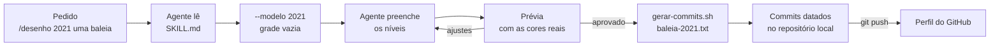
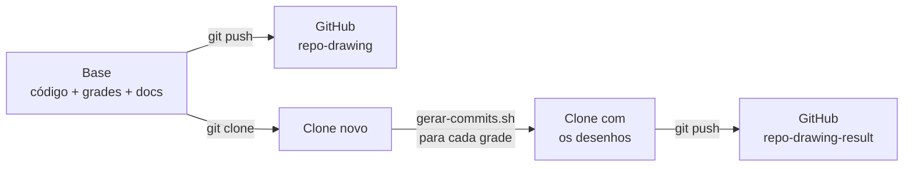

# 1. Visão geral

## A ideia em uma frase

O gráfico de contribuições do GitHub pinta cada dia conforme a quantidade de
commits daquele dia. Se você controla **quantos** commits existem em **cada
dia**, controla a cor de cada quadradinho e consegue desenhar.

O git permite escolher a data de um commit, e é isso que torna o desenho
possível: o projeto cria commits hoje, mas datados no passado.

## As três peças

| Peça | Onde | Papel |
|---|---|---|
| Grade de texto | `<nome>-<ano>.txt` | Descreve o desenho: um dígito de 0 a 4 por dia |
| Script | `.agents/skills/desenho/gerar-commits.sh` | Lê a grade, valida e cria os commits datados |
| Skill | `.agents/skills/desenho/SKILL.md` | Ensina um agente de IA a desenhar a grade, mostrar a prévia e chamar o script |

A separação é proposital:

- **A grade é o dado.** Texto puro, fácil de ler, versionar e reaproveitar. Uma
  grade pronta pode ser regerada em outro repositório a qualquer momento.
- **O script é determinístico.** Mesma grade, mesmos commits nas mesmas datas.
  Ele não precisa de agente: funciona direto no terminal.
- **A skill é a parte criativa e a conversa.** O agente cuida do que um script
  não sabe fazer bem (transformar "uma baleia nadando" em pixels, mostrar a
  prévia, ajustar até a pessoa aprovar) e delega o trabalho mecânico ao script.

Essa divisão vale para qualquer projeto com agentes: o modelo decide e conversa,
o código executa e confere.

## O caminho de um desenho

1. **Conferir o ano.** Só cabe um desenho por ano no mesmo repositório, porque
   o GitHub soma os commits de cada dia (detalhes no
   [capítulo 2](02-grafico-de-contribuicoes.md)).
2. **Gerar a grade vazia.** `gerar-commits.sh --modelo <ano>` imprime 7 linhas
   com `0` nos dias do ano e `.` nos dias que não existem. É o "papel
   quadriculado" do ano certo.
3. **Desenhar.** Trocar os `0` pelos níveis do desenho.
4. **Prévia.** Ver o desenho com as cores reais antes de criar qualquer commit.
   Desfazer commits dá trabalho; editar texto, não.
5. **Gerar os commits.** O script cria N commits por dia, conforme o nível, e
   no fim confere a contagem no próprio git.
6. **Enviar.** `git push`. O desenho aparece quando o GitHub processa os
   commits.

## Base e clones: como refazer os desenhos

O projeto separa duas coisas:

- **A base** é o repositório de referência (`repo-drawing` no GitHub): código,
  grades e documentação, com commits normais. Ela nunca recebe commits de
  desenho.
- **O repositório dos desenhos** é um clone da base onde o script gera os
  commits retroativos. Ele vai para o GitHub com outro nome, como
  `repo-drawing-result`.

Para trocar um desenho, não se edita o histórico: clona-se a base numa pasta
nova, geram-se todos os desenhos de novo e troca-se o repositório dos desenhos
no GitHub (a pessoa apaga o antigo e envia o novo). A referência não muda. Reescrever o histórico com
`git rebase` ou `git filter-repo` também funcionaria, mas:

- o clone é descartável: se algo der errado, apaga-se a pasta e começa-se de
  novo, sem risco para a base;
- nada local precisa ser apagado (nem `.git`, nem grades), então não há como
  perder trabalho por engano;
- gerar de novo a partir das grades é previsível e conferido pelo próprio
  script;
- um `push --force` com centenas de commits reescritos é mais fácil de errar do
  que trocar um repositório por outro.

Duas condições tornam isso possível. As grades precisam estar commitadas na
base, porque o clone só leva o que está no git. E os commits normais da base
vão junto para o clone, nas datas em que foram feitos: eles não atrapalham os
desenhos, mas ocupam o próprio ano, que fica fora dos desenhos (o script recusa
um ano que já tem commits).

O passo a passo está no [README](../README.md#fazer-uma-nova-sequência-de-desenhos).

## Próximo passo

Entenda o que o GitHub realmente conta: [2. O gráfico de contribuições](02-grafico-de-contribuicoes.md).
