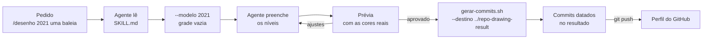
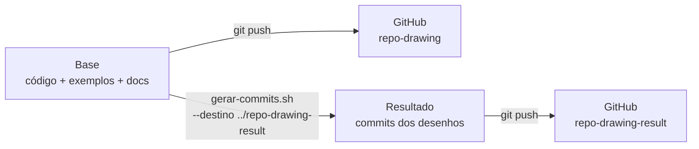

# 1. Visão geral

## A ideia em uma frase

O gráfico de contribuições do GitHub pinta cada dia conforme a quantidade de
commits daquele dia. Se você controla **quantos** commits existem em **cada
dia**, controla a cor de cada quadradinho e consegue desenhar.

O git permite escolher a data de um commit, e é isso que torna o desenho
possível: o projeto cria commits hoje, mas datados no passado.

## As três peças

| Peça | Onde | Papel |
|---|---|---|
| Grade de texto | `exemplos/` ou `desenhos-gerados/` | Descreve o desenho: um dígito de 0 a 4 por dia |
| Script | `.agents/skills/desenho/gerar-commits.sh` | Lê a grade, valida e cria os commits datados |
| Skill | `.agents/skills/desenho/SKILL.md` | Ensina um agente de IA a desenhar a grade, mostrar a prévia e chamar o script |

A separação é proposital:

- **A grade é o dado.** Texto puro, fácil de ler, versionar e reaproveitar. Uma
  grade pronta pode ser regerada em outro repositório a qualquer momento.
- **O script é determinístico.** Mesma grade, mesmos commits nas mesmas datas.
  Ele não precisa de agente: funciona direto no terminal.
- **A skill é a parte criativa e a conversa.** O agente cuida do que um script
  não sabe fazer bem (transformar "uma baleia nadando" em pixels, mostrar a
  prévia, ajustar até a pessoa aprovar) e delega o trabalho mecânico ao script.

Essa divisão vale para qualquer projeto com agentes: o modelo decide e conversa,
o código executa e confere.

## O caminho de um desenho

1. **Conferir o ano.** Só cabe um desenho por ano no resultado, porque
   o GitHub soma os commits de cada dia (detalhes no
   [capítulo 2](02-grafico-de-contribuicoes.md)).
2. **Gerar a grade vazia.** `gerar-commits.sh --modelo <ano>` imprime 7 linhas
   com `0` nos dias do ano e `.` nos dias que não existem. É o "papel
   quadriculado" do ano certo.
3. **Desenhar.** Trocar os `0` pelos níveis do desenho. A grade nova fica em
   `desenhos-gerados/`, fora do git da base.
4. **Prévia.** Ver o desenho com as cores reais antes de criar qualquer commit.
   Desfazer commits dá trabalho; editar texto, não.
5. **Gerar os commits.** O script cria N commits por dia no resultado,
   conforme o nível, e no fim confere a contagem no próprio git.
6. **Enviar.** `git push` no resultado. O desenho aparece quando o GitHub
   processa os commits.

## Base e resultado: onde ficam os desenhos

O projeto separa dois repositórios, lado a lado:

| | Base (`repo-drawing`) | Resultado (`repo-drawing-result`) |
|---|---|---|
| Conteúdo | Código, skill, grades de exemplo e documentação | Só os commits dos desenhos e um README |
| Commits | Normais, na data em que foram feitos | Retroativos, um conjunto por dia desenhado |
| Muda quando | O projeto evolui | Um desenho é acrescentado ou a sequência é refeita |

Tudo é feito a partir da base. O script recebe a grade pelo caminho e, com
`--destino`, muda para a pasta do resultado antes de criar os commits (criando
o repositório, se for preciso). Assim:

- o histórico da base fica só com o projeto, e o do resultado só com os
  desenhos;
- nenhum ano fica de fora por causa dos commits do projeto, que estão em outro
  repositório;
- as grades que você cria ficam em `desenhos-gerados/`, ignorada pelo git:
  experimentar não suja a base. Uma grade que valha a pena guardar vai para
  `exemplos/` e é commitada.

O resultado tem um único commit "normal": o `README.md`, que explica o que são
aqueles commits e aponta para a base. Ele é criado depois dos desenhos, com a
data do dia, então cai no ano atual, que por isso não serve para desenho.

### Refazer os desenhos

Para trocar um desenho, não se edita o histórico: geram-se todos os desenhos
de novo numa pasta de resultado nova e troca-se o repositório no GitHub (a
pessoa apaga o antigo e envia o novo com o mesmo nome). Reescrever o histórico
com `git rebase` ou `git filter-repo` também funcionaria, mas:

- a pasta nova é descartável: se algo der errado, apaga-se e começa-se de novo,
  sem risco para a base nem para o resultado antigo;
- nada local precisa ser apagado (nem `.git`, nem grades), então não há como
  perder trabalho por engano;
- gerar de novo a partir das grades é previsível e conferido pelo próprio
  script;
- um `push --force` com centenas de commits reescritos é mais fácil de errar do
  que trocar um repositório por outro.

O passo a passo está no [README](../README.md#fazer-uma-nova-sequência-de-desenhos).

## Próximo passo

Entenda o que o GitHub realmente conta: [2. O gráfico de contribuições](02-grafico-de-contribuicoes.md).
